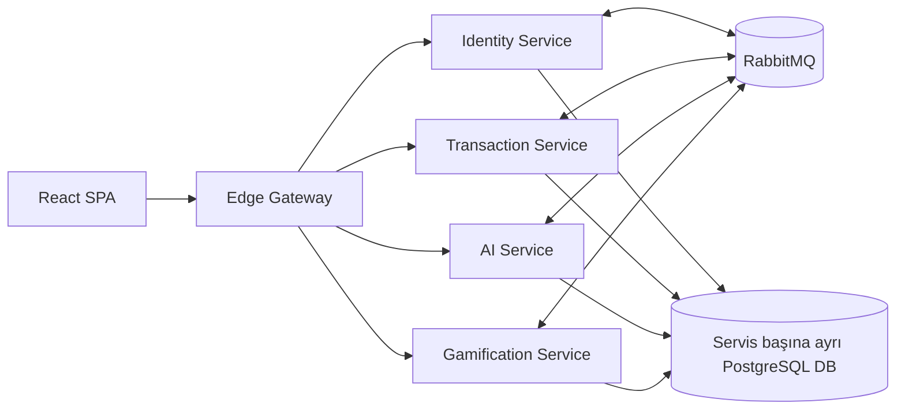

# FraudCell

FraudCell; müşteri işlemlerini makine öğrenmesiyle skorlayan, risk vakalarını uygun
analiste atayan ve analist performansını oyunlaştıran event-driven bir fraud operasyon
platformudur. Uygulamanın tek dış giriş noktası Edge Gateway'dir; frontend de gateway
tarafından `http://127.0.0.1:8080` adresinde sunulur.

## Mimari



Stack 7 container'dan oluşur: Edge, Identity, Transaction, AI, Gamification,
PostgreSQL ve RabbitMQ. PostgreSQL tek instance içinde servis başına ayrı database ve
ayrı uygulama rolü kullanır. Yalnızca gateway host portu açar.

## Hızlı başlangıç

Gereksinim yalnızca Docker (Docker Desktop ya da Docker Engine) ve Docker Compose v2.
Başka bir SDK kurmak gerekmez; AI modeli de image build edilirken eğitilir.

macOS / Linux:

```bash
make up      # .env yoksa .env.example'dan oluşturur, image'ları build edip sistemi başlatır
make demo    # zorunlu demo akışını uçtan uca doğrular
```

Windows: `scripts\start-fraudcell.bat`

Make olmadan, her işletim sisteminde:

```bash
cd BACKEND
cp .env.example .env
docker compose up -d --build
```

İlk açılışta image'lar build edildiği için birkaç dakika sürer. Tüm servisler sağlıklı
olunca tek seferlik `demo-seed` görevi demo personelini API üzerinden açar.

- Uygulama: `http://127.0.0.1:8080`
- Gateway health: `http://127.0.0.1:8080/health/ready`

### Demo kullanıcıları

| Rol | Giriş | Şifre |
|---|---|---|
| Admin | `admin@fraudcell.local` | `ChangeMe123!` |
| Süpervizör | `supervisor@fraudcell.local` | `Demo1234!` |
| Analist, Çalıntı Kart | `analyst.kart@fraudcell.local` | `Demo1234!` |
| Analist, Hesap Ele Geçirme | `analyst.hesap@fraudcell.local` | `Demo1234!` |
| Analist, Para Aklama | `analyst.aklama@fraudcell.local` | `Demo1234!` |
| Analist, Şüpheli Davranış | `analyst.davranis@fraudcell.local` | `Demo1234!` |
| Müşteri | herhangi bir `5xxxxxxxxx` GSM numarası | OTP: `1234` |

Bu hesaplar yalnızca yerel demo (`Development`) içindir; şifreler `BACKEND/.env` dosyasından
değiştirilebilir. Durdurmak için `make down` (veriler kalır), sıfırlamak için `make reset`.

## Zorunlu demo akışı

Case'in 11.3 bölümündeki akış [`scripts/demo.py`](scripts/demo.py) ile doğrulanır; aynı
kontrol CI'da her PR'da temiz bir makinede `docker compose up` ile çalışır.

1. `make up`: tüm sistem `docker compose up` ile açılır.
2. `make demo`: müşteri gece, yurt dışından 50.000 TL transfer yapar. AI risk skorunu, türü
   ve kararı üretir; vaka o türün uzmanı olan analiste atanır. Analist inceleyip blok kararı
   verir, puan liderlik tablosuna yansır.
3. `make demo-ai-down`: AI servisi durdurulur. Yeni işlem yine kaydedilir, `TIMED_OUT` olur
   ve vaka süpervizörün manuel kuyruğuna düşer. Ardından AI yeniden başlatılır.

Aynı adımlar arayüzden yukarıdaki müşteri, analist ve süpervizör hesaplarıyla gösterilebilir.

## Doğrulama

```powershell
dotnet build BACKEND/FraudCell.sln -c Release
dotnet test BACKEND/FraudCell.sln -c Release

cd BACKEND/src/Ai/fraudcell-ai
uv run ruff check .
uv run mypy app
uv run pytest -q

cd ../../../../FRONTEND/app
npm test
npm run typecheck
npm run build
$env:PLAYWRIGHT_BASE_URL='http://127.0.0.1:8080'
npm run e2e
```

## Dokümantasyon

- Gereksinim izlenebilirliği: [BACKEND/docs/01-REQUIREMENTS-TRACEABILITY.md](BACKEND/docs/01-REQUIREMENTS-TRACEABILITY.md)
- Mimari ve servis sınırları: [BACKEND/docs/02-ARCHITECTURE-OVERVIEW.md](BACKEND/docs/02-ARCHITECTURE-OVERVIEW.md)
- State machine: [BACKEND/docs/05-DOMAIN-AND-STATE-MACHINE.md](BACKEND/docs/05-DOMAIN-AND-STATE-MACHINE.md)
- Event kataloğu: [BACKEND/EVENTS.md](BACKEND/EVENTS.md)
- AI yaklaşımı/eğitim: [BACKEND/docs/10-AI-SERVICE-DESIGN.md](BACKEND/docs/10-AI-SERVICE-DESIGN.md)
- Sunum ve teslim playbook'u: [BACKEND/docs/11-FINAL-DELIVERY-PLAYBOOK.md](BACKEND/docs/11-FINAL-DELIVERY-PLAYBOOK.md)
- OpenAPI snapshot'ları: `BACKEND/contracts/openapi/`

Servislerin sorumlulukları, endpoint grupları ve environment değişkenleri kendi
klasörlerindeki README dosyalarında yer alır.
