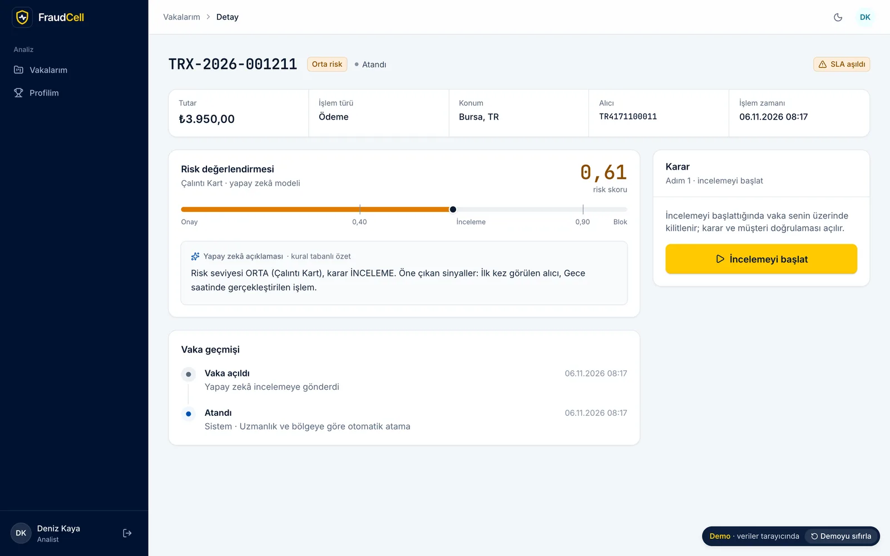
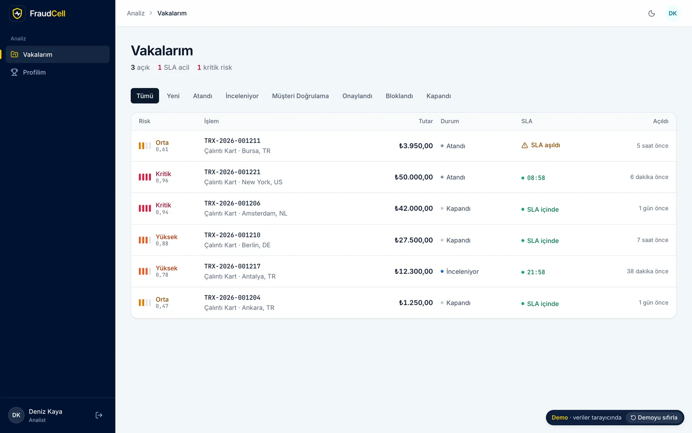
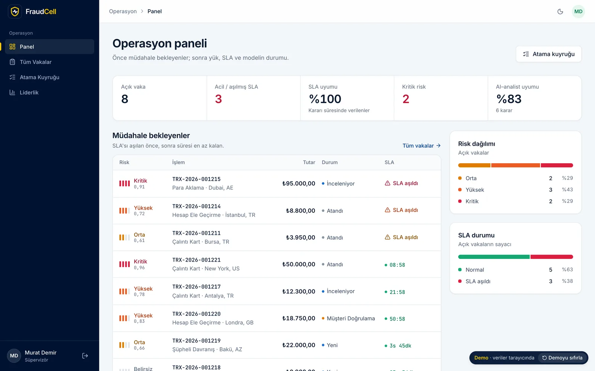
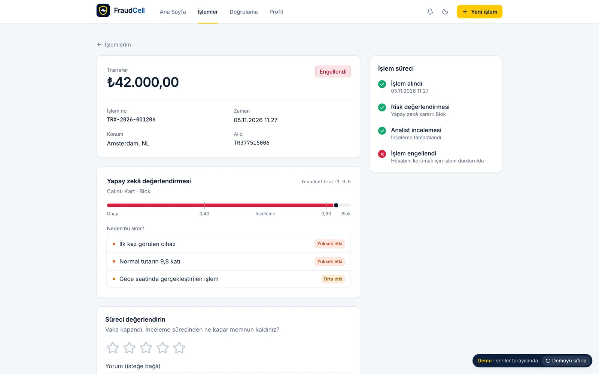
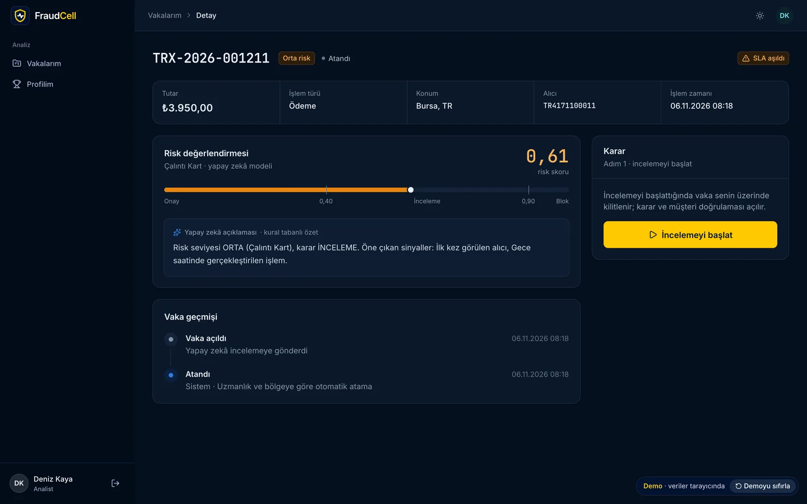
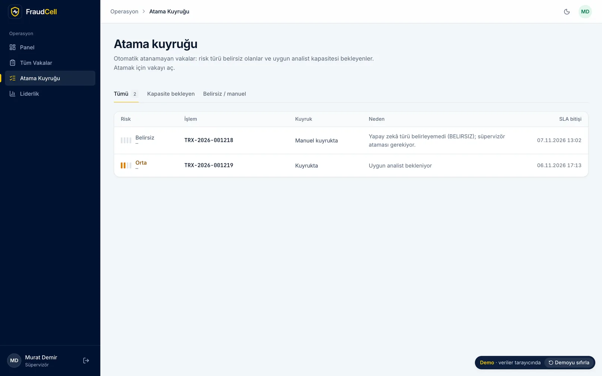
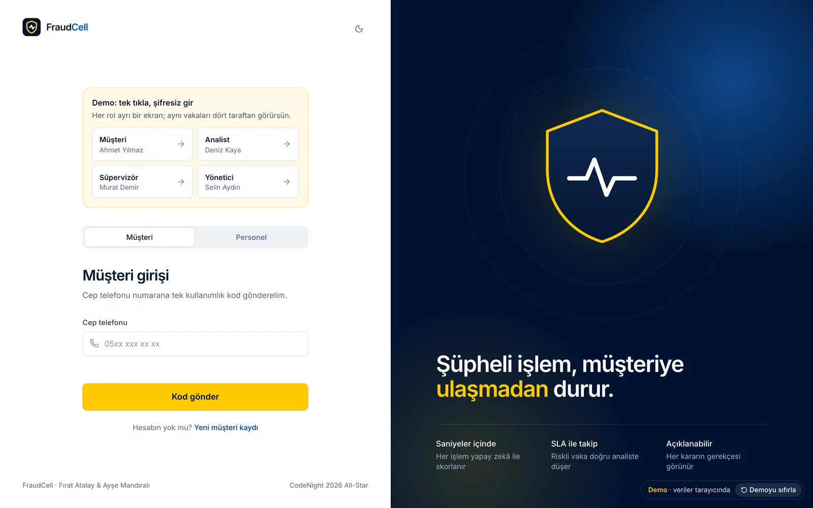
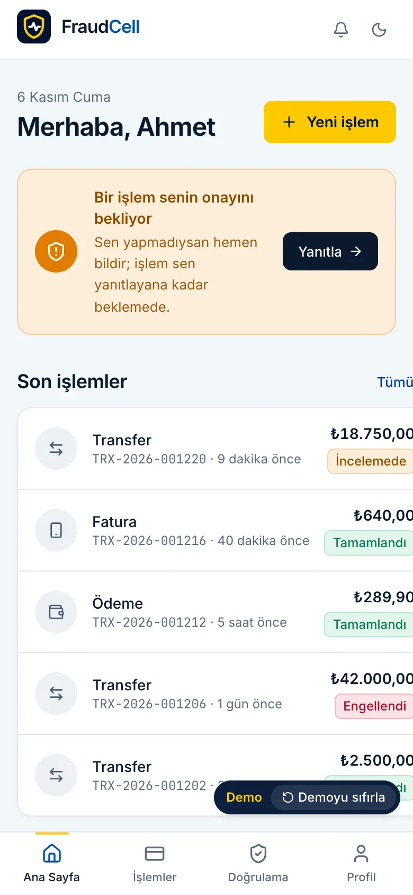
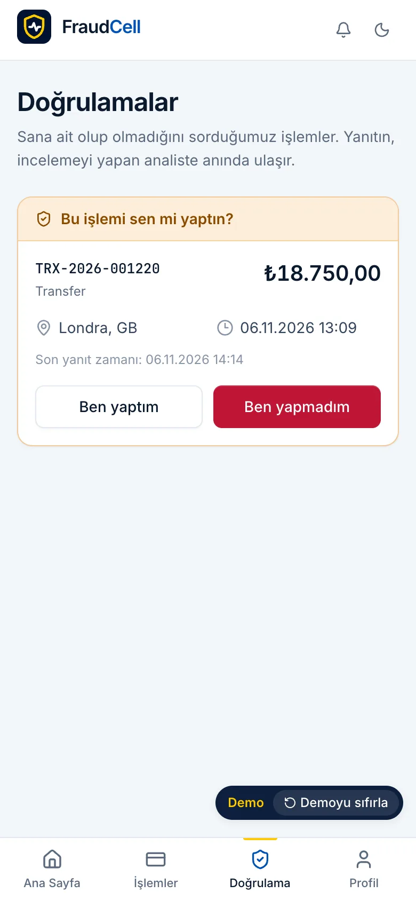
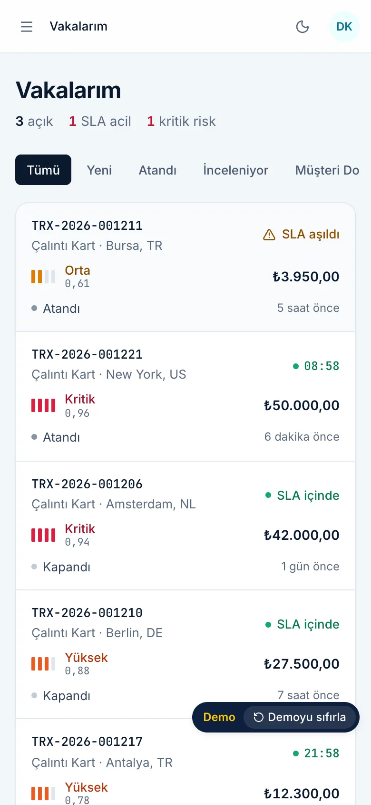

<p align="center">
  
</p>

<h1 align="center">FraudCell</h1>

<p align="center">
  An event-driven microservice platform that catches fraud in digital payments with AI, assigns risky transactions to
  the right analyst and tracks them against an SLA.<br>
  Turkcell CodeNight 2026 All-Star final, "FraudCell" case.
</p>

<p align="center">
  <a href="https://fraud-cell.vercel.app"><b>Live demo</b></a> ·
  <a href="docs/en/README.md"><b>Documentation</b></a> ·
  <a href="README.md">Türkçe</a>
</p>

<p align="center">
  
  
  
  
  
  
</p>

## In my words

We built FraudCell overnight at the Turkcell CodeNight 2026 All-Star final, as a team of two that I captained (Ayşe
Mandıralı and me). The case: score every payment with AI, turn risky ones into cases for an analyst with the right
specialty, track them against an SLA, ask the customer "was this you?" when needed, and score the analysts. When the
night ended the system worked, but it didn't start on a clean machine.

After the event I finished it on my own. I gave every service its own database and made events impossible to lose with
an outbox and an inbox. I wrote the 96 attacks the jury would try into a script that runs in CI, and rebuilt the UI as a
case-management tool. I wrote a large part of the code with AI (Claude Code), under rules I set: a red test first, and no
merge without green CI.

## How to review it

| Time | What | Where |
|---|---|---|
| 1 min | Sign in as any of the four roles, one click, no password | [Live demo](https://fraud-cell.vercel.app) |
| 5 min | A non-technical tour | [02 Demo tour](docs/en/02-demo-tour.md) |
| 15 min | Architecture and the problems I solved | [03 Architecture](docs/en/03-architecture.md), [11 Problems I solved](docs/en/11-problems-i-solved.md) |
| The real system | One command: `make up` | [10 Running and API](docs/en/10-running-and-api.md) |

## Story: before and after

| Topic | End of the hackathon | Today |
|---|---|---|
| Clean-machine start | Failed | `make up` |
| Databases | One Postgres | A Postgres per service, private networks, JWKS |
| Point rule | Every block earned +15 | +15 only when the customer said "it wasn't me" |
| Security | Customers could read staff points | 96 attack checks on every PR |
| Tests | 5 C# tests | 51 .NET, 49 Python, 11 unit, 2 browser tests |
| CI | Red | 5 green jobs, including an end-to-end demo on a clean machine |

More in [01 Story](docs/en/01-story.md).

## Screenshots

The interface is in Turkish.

| | |
|---|---|
|  The analyst's inbox: riskiest and most urgent first, live SLA countdown |  The supervisor dashboard opens with cases needing action |
|  The customer sees the outcome, the progress and the AI's reasons |  Dark theme |
|  Cases that couldn't be assigned automatically |  Demo: one-click sign-in for each role |

<p align="center">
  
  
  
</p>

## Engineering highlights

1. **A database per service:** four Postgres instances, each on its own service's network; other services' data arrives
   through event-fed projections. → [04](docs/en/04-database.md)
2. **Outbox and inbox:** data and event are written in one database transaction; a repeated event is skipped. → [03](docs/en/03-architecture.md#events-and-delivery-guarantees)
3. **Nothing is lost when the AI is down:** with no result in 5 seconds, the case opens with an unknown risk in the
   manual queue; CI tests it by stopping the AI container. → [11](docs/en/11-problems-i-solved.md#2-a-transaction-must-not-be-lost-when-the-ai-is-down)
4. **State machine plus database constraints:** rules such as one active assignment per case and at most 10 cases per
   analyst are enforced by the database too. → [04](docs/en/04-database.md#rules-the-database-enforces)
5. **ETag / If-Match:** if two supervisors write to the same case at once, the second gets 412; nobody overwrites a
   decision without knowing. → [04](docs/en/04-database.md#concurrency-etag-and-if-match)
6. **The customer as ground truth:** points and model accuracy come from the customer's "it was me / it wasn't me".
   → [05](docs/en/05-domain-rules.md#customer-verification)
7. **Two calibrated models and honest metrics:** recall is 0.52, and I say so. → [07](docs/en/07-ai.md#metrics-honestly)
8. **JWKS and refresh-token rotation:** the private key stays in Identity; reusing a stolen token ends every session.
   → [06](docs/en/06-security.md)
9. **The jury's list as a script:** 96 security checks (IDOR, role matrix, JWT tampering, SQLi, XSS, brute force) run
   against the real system on every PR. → [06](docs/en/06-security.md#the-jurys-list-became-a-script)
10. **A separate service for SSE:** live notifications moved out of the gateway; the browser connects with a short-lived
    ticket. → [11](docs/en/11-problems-i-solved.md#7-live-notifications-lived-inside-the-gateway)
11. **One screen codebase, two transports:** the live demo runs on a Service Worker in the browser; no demo code ships in
    the live build. → [08](docs/en/08-frontend-and-design.md#demo-mode)
12. **End-to-end CI on a clean machine:** every PR runs `docker compose up --build`, the demo flow, resilience, a browser
    test through all four roles and the security checks. → [09](docs/en/09-deployment-strategy.md#ci-five-jobs-on-every-pr)

## Architecture

```mermaid
flowchart LR
  B[Browser] --> G[Edge Gateway YARP]
  G --> I[Identity]
  G --> T[Transaction]
  G --> GM[Gamification]
  G --> A[AI FastAPI]
  G -->|SSE| N[Notification]
  I <--> R{{RabbitMQ}}
  T <--> R
  GM <--> R
  A <--> R
  N <-- R
```

Every service has its own Postgres. Details: [03 Architecture](docs/en/03-architecture.md).

| Layer | Technologies |
|---|---|
| Backend | .NET 10, ASP.NET Core, EF Core 10, YARP 2.3, ASP.NET Core Identity (Argon2id), RabbitMQ.Client 7 |
| AI | Python 3.13, FastAPI, scikit-learn 1.5, SQLAlchemy 2, Alembic |
| Data | PostgreSQL 18 (one per service), RabbitMQ 4.3 |
| Frontend | React 19, TypeScript 5.9, Vite 8, TanStack Router and Query, Tailwind CSS 4, MSW 2 |
| Tests and CI | xUnit v3, Testcontainers, pytest, Vitest, Playwright, GitHub Actions |

## Run it with one command

```bash
git clone https://github.com/mrfiratatalay/FraudCell.git && cd FraudCell
make up          # Windows: scripts\start-fraudcell.bat
# http://127.0.0.1:8080
```

Demo users, environment variables and curl examples: [10 Running and API](docs/en/10-running-and-api.md).

## Documentation

| | | |
|---|---|---|
| [01 Story](docs/en/01-story.md) | [05 Domain rules](docs/en/05-domain-rules.md) | [09 Deployment strategy](docs/en/09-deployment-strategy.md) |
| [02 Demo tour](docs/en/02-demo-tour.md) | [06 Security](docs/en/06-security.md) | [10 Running and API](docs/en/10-running-and-api.md) |
| [03 Architecture](docs/en/03-architecture.md) | [07 AI](docs/en/07-ai.md) | [11 Problems I solved](docs/en/11-problems-i-solved.md) |
| [04 Database](docs/en/04-database.md) | [08 Frontend and design](docs/en/08-frontend-and-design.md) | [12 FAQ and limits](docs/en/12-faq-and-limits.md) |

## Project layout

```
BACKEND/
  src/BuildingBlocks/      shared infrastructure: API envelope, outbox/inbox, RabbitMQ, JWT
  src/Services/            Edge Gateway, Identity, Transaction, Gamification, Notification
  src/Ai/fraudcell-ai/     FastAPI + scikit-learn, data and model card
  tests/                   xUnit + Testcontainers
  contracts/openapi/       OpenAPI snapshots
  docker-compose.yml       the whole system, one command
FRONTEND/app/              React SPA, demo mode (src/demo), Playwright tests
scripts/                   demo.py (mandatory flow), security.py (the jury's attacks)
docs/                      documentation (Turkish), docs/en (English)
```

## Team

- **Fırat Atalay**, captain. On the hackathon night: integration, the AI-down flow and the UI; after the event: all of
  the completion work.
- **Ayşe Mandıralı.** On the hackathon night: the architecture documents, the first versions of the Identity and
  Transaction services, and the frontend's foundation.

Thanks to the Turkcell CodeNight team for the case. The repository as it stood on the hackathon night is kept in the
`allstar-final-2026-07-23` tag.

**Brand notice:** The UI uses Turkcell's yellow and navy as a nod to the event. The Turkcell name and logo are not part
of the product; this is not an official Turkcell product and is not affiliated with Turkcell.
