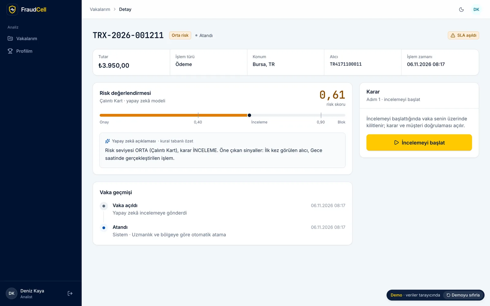
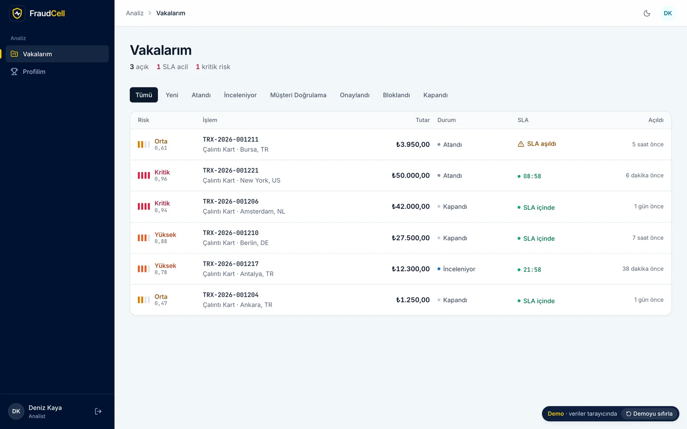
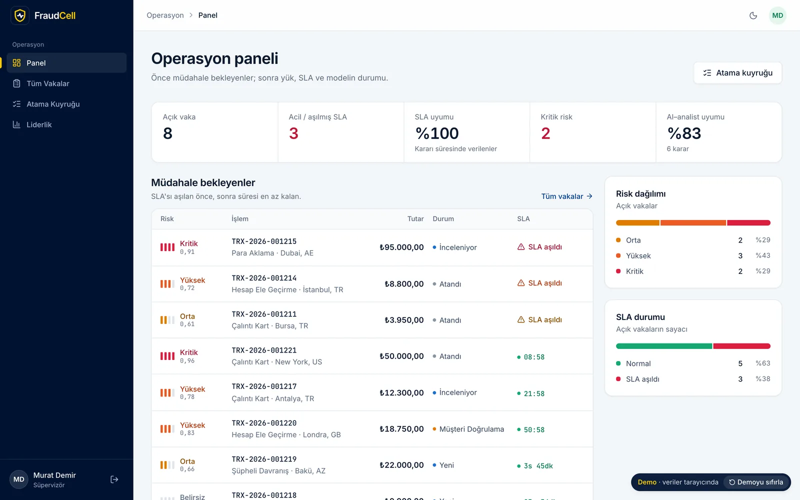
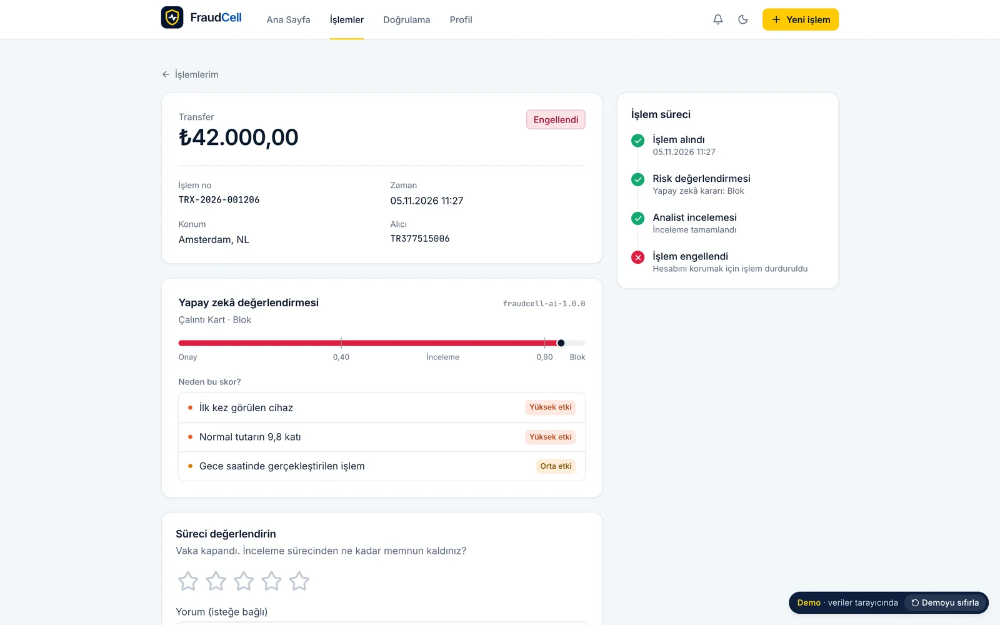
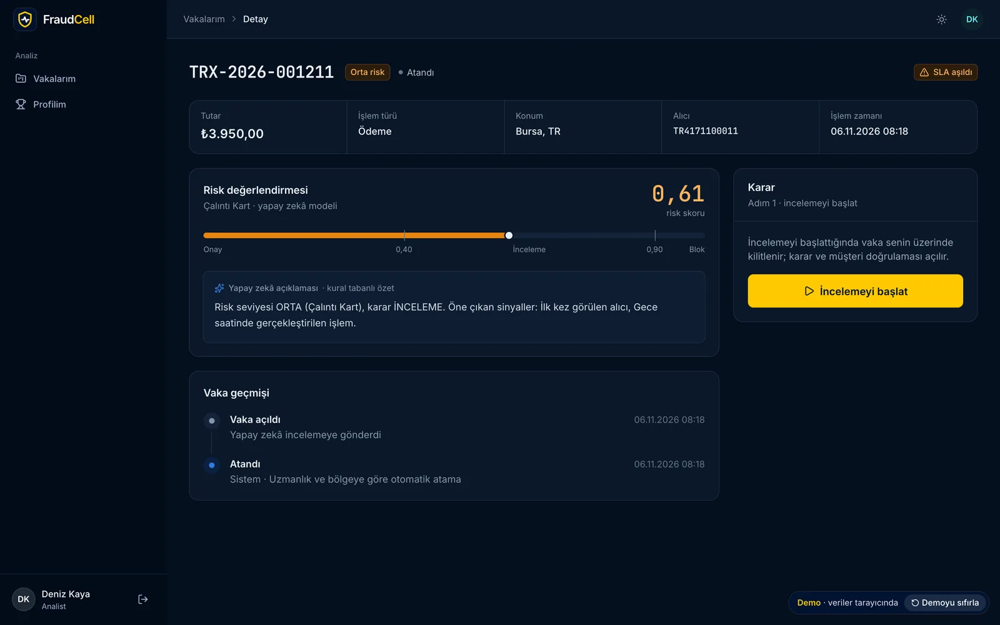
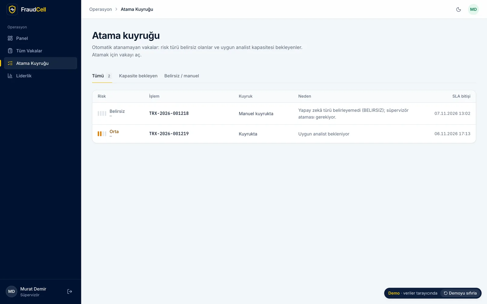
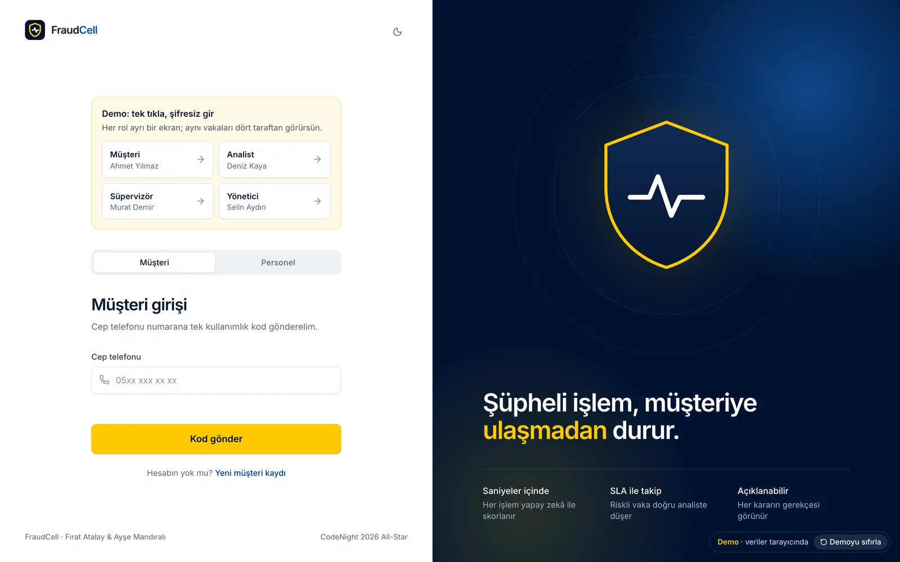
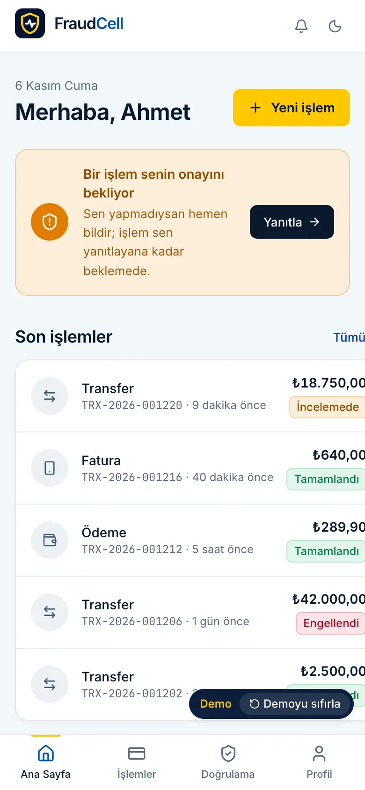
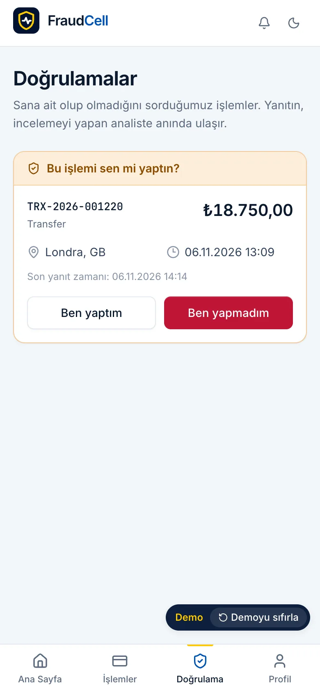
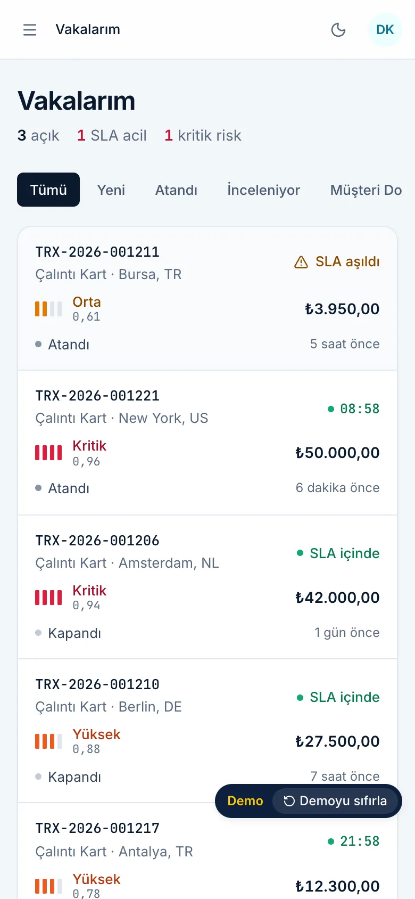

<p align="center">
  
</p>

<h1 align="center">FraudCell</h1>

<p align="center">
  Dijital ödemelerde dolandırıcılığı yapay zekâyla yakalayan, riskli işlemi doğru analiste atayıp SLA ile takip eden
  olay güdümlü bir mikroservis platformu.<br>
  Turkcell CodeNight 2026 All-Star finali, "FraudCell" vakası.
</p>

<p align="center">
  <a href="https://fraud-cell.vercel.app"><b>Canlı demo</b></a> ·
  <a href="docs/README.md"><b>Dokümanlar</b></a> ·
  <a href="README.en.md">English</a>
</p>

<p align="center">
  
  
  
  
  
  
</p>

## Benim ağzımdan

FraudCell'i Turkcell CodeNight 2026 All-Star finalinde, kaptanı olduğum iki kişilik takımla (Ayşe Mandıralı ve ben)
bir gecede yazdık. Vaka şuydu: her ödemeyi yapay zekâyla skorla, riskli olanı vakaya çevirip uzmanlığına uygun analiste
ata, SLA ile takip et, gerekirse müşteriye "bu işlemi sen mi yaptın?" diye sor ve analistleri puanla. Gece bittiğinde
sistem çalışıyordu ama temiz bir makinede açılmıyordu.

Etkinlikten sonra projeyi tek başıma tamamladım. Her servise kendi veritabanını verdim. Olayları outbox ve inbox ile
kaybolmaz hâle getirdim. Jürinin deneyeceği 96 saldırıyı bir betiğe yazıp CI'a bağladım. Arayüzü bir vaka yönetim aracı
gibi yeniden kurdum. Kodun önemli bir kısmını yapay zekâyla (Claude Code), kendi koyduğum kurallar altında yazdım:
önce kırmızı test, yeşil CI olmadan merge yok.

## Nasıl incelersin?

| Süre | Ne | Nereden |
|---|---|---|
| 1 dk | Dört rolle tek tıkla, şifresiz gir | [Canlı demo](https://fraud-cell.vercel.app) |
| 5 dk | Teknik olmayan tur | [02 Demo turu](docs/02-demo-turu.md) |
| 15 dk | Mimari ve çözdüğüm problemler | [03 Mimari](docs/03-mimari.md), [11 Çözdüğüm problemler](docs/11-cozdugum-problemler.md) |
| Gerçek sistem | Tek komut: `make up` | [10 Çalıştırma ve API](docs/10-calistirma-ve-api.md) |

## Hikâye: önce ve sonra

| Konu | Hackathon sonunda | Bugün |
|---|---|---|
| Temiz makinede açılış | Açılmıyordu | `make up` yeterli |
| Veritabanı | Tek Postgres | Servis başına Postgres, özel ağ, JWKS |
| Puan kuralı | Her blok +15 | +15 yalnızca müşteri "ben yapmadım" dediyse |
| Güvenlik | Müşteri personel puanlarını okuyabiliyordu | 96 saldırı denemesi her PR'da |
| Testler | 5 C# testi | 51 .NET, 49 Python, 11 birim, 2 tarayıcı testi |
| CI | Kırmızı | 5 iş yeşil, temiz makinede uçtan uca demo dahil |

Ayrıntısı: [01 Hikâye](docs/01-hikaye.md).

## Ekran görüntüleri

| | |
|---|---|
|  Analistin gelen kutusu: en riskli ve en acil üstte, SLA canlı geri sayar |  Süpervizör paneli "müdahale bekleyenler" ile açılır |
|  Müşteri işleminin sonucunu, sürecini ve AI gerekçesini görür |  Koyu tema |
|  Otomatik atanamayan vakalar |  Demo: her rol için tek tıkla giriş |

<p align="center">
  
  
  
</p>

## Mühendislik tarafında öne çıkanlar

1. **Servis başına veritabanı:** Dört Postgres, her biri yalnızca kendi servisinin ağında; başka servisin verisi
   olaylardan beslenen projeksiyonlarla geliyor. → [04](docs/04-veritabani.md)
2. **Outbox ve inbox:** Veri ve olay aynı DB işleminde yazılıyor; aynı olay iki kez gelirse atlanıyor. → [03](docs/03-mimari.md#olaylar-ve-teslim-garantisi)
3. **AI kapalıyken işlem kaybolmuyor:** 5 saniyede sonuç yoksa vaka "Belirsiz" riskle manuel kuyruğa açılıyor; CI bunu
   AI container'ını durdurarak test ediyor. → [11](docs/11-cozdugum-problemler.md#2-ai-kapalıyken-işlem-kaybolmamalı)
4. **Durum makinesi ve veritabanı kısıtları:** Bir vakanın tek aktif ataması, analist başına en fazla 10 vaka gibi
   kurallar veritabanında da korunuyor. → [04](docs/04-veritabani.md#veritabanının-kendisi-korur)
5. **ETag / If-Match:** Aynı vakaya iki süpervizör aynı anda yazarsa ikincisi 412 alıyor; kimse başkasının kararını
   fark etmeden ezmiyor. → [04](docs/04-veritabani.md#eşzamanlılık-etag-ve-if-match)
6. **Ground truth olarak müşteri:** Puanlar ve modelin doğruluğu müşterinin "ben yaptım / yapmadım" cevabından
   hesaplanıyor. → [05](docs/05-is-kurallari.md#müşteri-doğrulaması)
7. **Kalibre edilmiş iki model ve dürüst metrikler:** Recall 0,52; sınırı saklamıyorum. → [07](docs/07-yapay-zeka.md#metrikler-dürüst-hâli)
8. **JWKS ve refresh token rotation:** Private key yalnızca Identity'de; çalınan token tekrar kullanılırsa bütün
   oturumlar kapanıyor. → [06](docs/06-guvenlik.md)
9. **Jürinin listesi bir betik:** 96 güvenlik kontrolü (IDOR, rol matrisi, JWT oynama, SQLi, XSS, brute force) her
   PR'da gerçek sisteme karşı. → [06](docs/06-guvenlik.md#jüri-listesi-bir-betik-oldu)
10. **SSE için ayrı servis:** Canlı bildirimler gateway'den ayrıldı; tarayıcı kısa ömürlü bir biletle bağlanıyor. → [11](docs/11-cozdugum-problemler.md#7-gerçek-zamanlı-bildirim-gatewayin-içindeydi)
11. **Aynı ekran kodu, iki taşıma katmanı:** Canlı demo tarayıcıda Service Worker ile çalışıyor; canlı derlemeye demo
    kodu girmiyor. → [08](docs/08-arayuz-ve-tasarim.md#demo-modu)
12. **Temiz makinede uçtan uca CI:** Her PR'da `docker compose up --build`, demo akışı, dayanıklılık, dört rolün
    tarayıcı testi ve güvenlik kontrolleri. → [09](docs/09-yayin-stratejisi.md#ci-her-prda-beş-iş)

## Mimari

```mermaid
flowchart LR
  B[Tarayıcı] --> G[Edge Gateway YARP]
  G --> I[Identity]
  G --> T[Transaction]
  G --> GM[Gamification]
  G --> A[AI FastAPI]
  G -->|SSE| N[Notification]
  I <--> R{{RabbitMQ}}
  T <--> R
  GM <--> R
  A <--> R
  N <-- R
```

Her servisin kendi Postgres'i var. Ayrıntısı: [03 Mimari](docs/03-mimari.md).

| Katman | Teknolojiler |
|---|---|
| Backend | .NET 10, ASP.NET Core, EF Core 10, YARP 2.3, ASP.NET Core Identity (Argon2id), RabbitMQ.Client 7 |
| AI | Python 3.13, FastAPI, scikit-learn 1.5, SQLAlchemy 2, Alembic |
| Veri | PostgreSQL 18 (servis başına), RabbitMQ 4.3 |
| Frontend | React 19, TypeScript 5.9, Vite 8, TanStack Router ve Query, Tailwind CSS 4, MSW 2 |
| Test ve CI | xUnit v3, Testcontainers, pytest, Vitest, Playwright, GitHub Actions |

## Tek komutla çalıştır

```bash
git clone https://github.com/mrfiratatalay/FraudCell.git && cd FraudCell
make up          # Windows: scripts\start-fraudcell.bat
# http://127.0.0.1:8080
```

Demo kullanıcıları, ortam değişkenleri ve curl örnekleri: [10 Çalıştırma ve API](docs/10-calistirma-ve-api.md).

## Dokümanlar

| | | |
|---|---|---|
| [01 Hikâye](docs/01-hikaye.md) | [05 İş kuralları](docs/05-is-kurallari.md) | [09 Yayın stratejisi](docs/09-yayin-stratejisi.md) |
| [02 Demo turu](docs/02-demo-turu.md) | [06 Güvenlik](docs/06-guvenlik.md) | [10 Çalıştırma ve API](docs/10-calistirma-ve-api.md) |
| [03 Mimari](docs/03-mimari.md) | [07 Yapay zekâ](docs/07-yapay-zeka.md) | [11 Çözdüğüm problemler](docs/11-cozdugum-problemler.md) |
| [04 Veritabanı](docs/04-veritabani.md) | [08 Arayüz ve tasarım](docs/08-arayuz-ve-tasarim.md) | [12 Sorular ve sınırlar](docs/12-sorular-ve-sinirlar.md) |

## Proje yapısı

```
BACKEND/
  src/BuildingBlocks/      ortak altyapı: API zarfı, outbox/inbox, RabbitMQ, JWT
  src/Services/            Edge Gateway, Identity, Transaction, Gamification, Notification
  src/Ai/fraudcell-ai/     FastAPI + scikit-learn, veri ve model kartı
  tests/                   xUnit + Testcontainers
  contracts/openapi/       OpenAPI anlık görüntüleri
  docker-compose.yml       tek komutluk sistem
FRONTEND/app/              React SPA, demo modu (src/demo), Playwright testleri
scripts/                   demo.py (zorunlu akış), security.py (jüri saldırıları)
docs/                      bu dokümanlar (Türkçe) ve docs/en (İngilizce)
```

## Ekip

- **Fırat Atalay**, kaptan. Hackathon gecesinde entegrasyon, AI kapalıyken akış ve arayüz; etkinlik sonrası tamamlamanın
  tamamı.
- **Ayşe Mandıralı.** Hackathon gecesinde mimari dokümanlar, Identity ve Transaction servislerinin ilk hâli, frontend
  temeli.

Vakayı hazırlayan Turkcell CodeNight ekibine teşekkürler. Hackathon gecesinin hâli `allstar-final-2026-07-23` tag'inde
duruyor.

**Marka uyarısı:** Arayüzde etkinliğe gönderme olarak Turkcell'in sarı ve lacivert renkleri kullanılmıştır. Turkcell adı
ve logosu ürünün parçası değildir; bu proje Turkcell'in resmî bir ürünü değildir ve Turkcell ile bir bağı yoktur.
