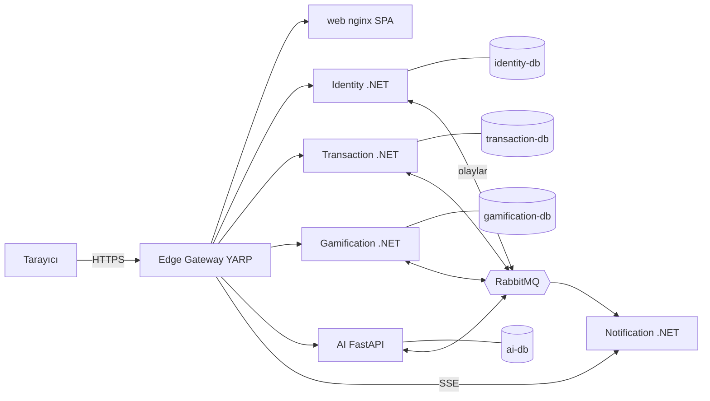
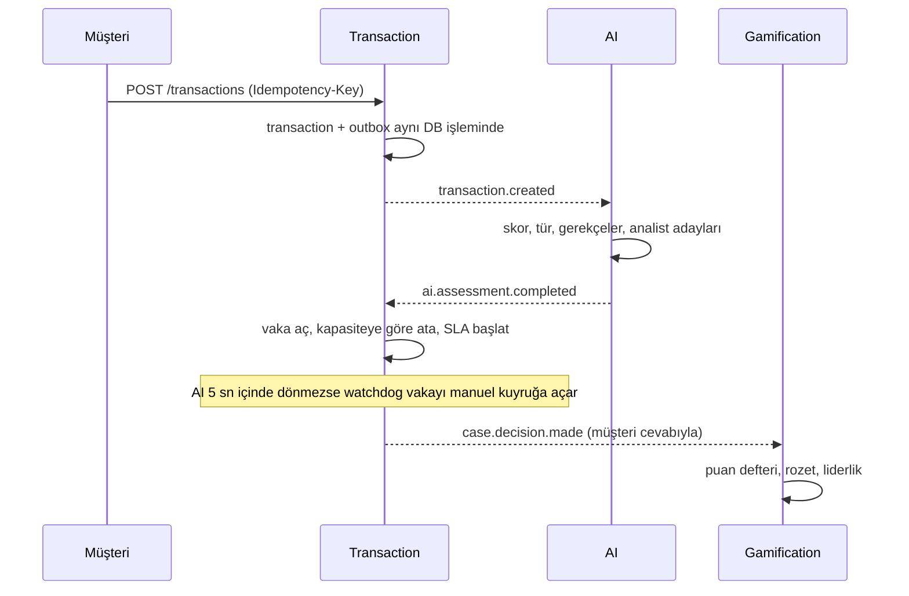

# 03. Mimari

## Büyük resim

| Servis | Sorumluluk | Teknoloji |
|---|---|---|
| Edge Gateway | Tek giriş noktası: yönlendirme, JWT kontrolü, hız sınırı, güvenlik başlıkları | ASP.NET Core 10, YARP 2.3 |
| Identity | Müşteri OTP girişi, personel girişi, oturumlar, personel yönetimi, denetim kaydı, JWKS | ASP.NET Core Identity, Argon2id |
| Transaction | İşlem, risk vakası, atama, SLA, müşteri doğrulaması, karar, geri bildirim | EF Core 10, Npgsql |
| AI | Risk skoru, fraud türü, analist adayları, açıklama, model metrikleri | FastAPI, scikit-learn 1.5, SQLAlchemy 2 |
| Gamification | Puan defteri, rozetler, seviye, liderlik, analist performansı | EF Core 10 |
| Notification | Olayları tarayıcıya canlı iletir (Server-Sent Events) | ASP.NET Core 10 |
| web | React SPA'yı sunar | nginx (unprivileged) |

Uç nokta sayıları koddan sayıldı: Identity 23, Transaction 20, AI 12, Gamification 7, Notification 2.

## Neden mikroservis ve neden bu sınırlar

**Problem:** Vaka, "AI kapalıyken de işlem kaybolmasın" ve "bir servis düştüğünde diğerleri çalışmaya devam etsin"
diyor. Tek bir uygulamada AI'ın yavaşlaması ödeme akışını da yavaşlatırdı.

**Çözüm:** Her iş alanı kendi servisinde ve kendi veritabanında. Servisler senkron birbirini çağırmak yerine RabbitMQ
üzerinden olay gönderir.

**Bedeli:** Dağıtık sistemin zorlukları geldi: aynı olayın iki kez gelmesi, sıralama, eventual consistency, yedi
container'ı birlikte ayağa kaldırmak. Bunları outbox/inbox ve tek komutluk compose ile çözdüm.

## Bir işlemin yolculuğu

1. Müşteri işlemi gönderir. Transaction işlemi ve `transaction.created` olayını **aynı veritabanı işleminde** yazar
   ([CreateTransactionEndpoint.cs](../BACKEND/src/Services/Transaction/FraudCell.Transaction.Service/Features/Transactions/CreateTransaction/CreateTransactionEndpoint.cs)).
2. Outbox yayıncısı olayı RabbitMQ'ya gönderir
   ([OutboxPublisherService.cs](../BACKEND/src/BuildingBlocks/FraudCell.BuildingBlocks/Messaging/Outbox/OutboxPublisherService.cs)).
3. AI skoru hesaplar ve `ai.assessment.completed` yayınlar; içinde analist adayları da vardır.
4. Transaction vakayı açar ve adaylardan kapasitesi olan ilk analisti seçer
   ([AssignmentService.cs](../BACKEND/src/Services/Transaction/FraudCell.Transaction.Service/Common/AssignmentService.cs)).
5. AI 5 saniyede cevap vermezse
   [AssessmentWatchdogWorker.cs](../BACKEND/src/Services/Transaction/FraudCell.Transaction.Service/BackgroundJobs/AssessmentWatchdogWorker.cs)
   vakayı "Belirsiz" risk ile manuel kuyruğa açar. İşlem kaybolmaz.

## Olaylar ve teslim garantisi

- **Outbox:** Olay, iş verisiyle aynı DB işleminde `outbox_messages` tablosuna yazılır; ayrı bir worker yayınlar.
  "Veriyi kaydettim ama olayı gönderemedim" durumu oluşmaz.
- **Inbox:** Her tüketici aldığı olayın kimliğini `inbox_messages` tablosuna yazar; aynı olay ikinci kez gelirse atlar
  ([RabbitMqConsumerHostedService.cs](../BACKEND/src/BuildingBlocks/FraudCell.BuildingBlocks/Messaging/RabbitMq/RabbitMqConsumerHostedService.cs)).
- Tam olay listesi: [EVENTS.md](../BACKEND/EVENTS.md).

## Paylaşılan kod

[FraudCell.BuildingBlocks](../BACKEND/src/BuildingBlocks/FraudCell.BuildingBlocks/) yalnızca altyapıyı paylaşır:
API zarfı, hata sözleşmesi, ETag, outbox/inbox, RabbitMQ, JWT doğrulama. İçinde `Transaction` ya da `RiskCase` gibi
hiçbir domain kavramı yoktur; her servis kendi modelini kendisi tutar.

## Çalışma zamanı

- Tek komut: `docker compose up` yedi uygulama container'ı, dört Postgres ve RabbitMQ açar
  ([docker-compose.yml](../BACKEND/docker-compose.yml)).
- Her veritabanı yalnızca kendi servisinin özel ağındadır; başka bir servis ona bağlanamaz.
- `demo-seed` container'ı demo personelini oluşturur. Gateway ise servisleri beklemeden açılır; düşen bir servis
  yalnızca kendi uç noktalarını etkiler.
- Dayanıklılık testi: [scripts/demo.py](../scripts/demo.py) `resilience` adımında her container'ı (RabbitMQ dahil) sırayla
  durdurup sistemin toparlandığını CI'da doğrular.
