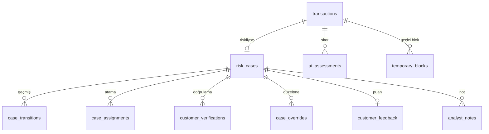

# 04. Veritabanı

## Servis başına bir veritabanı

| Veritabanı | Sahibi | Tablo sayısı | Migration |
|---|---|---|---|
| `fraudcell_identity` | Identity | 19 (ASP.NET Identity tabloları dahil) | EF Core |
| `fraudcell_transaction` | Transaction | 16 | EF Core |
| `fraudcell_gamification` | Gamification | 12 | EF Core |
| `fraudcell_ai` | AI | 14 | Alembic |

Dört ayrı Postgres 18 container'ı var ve her biri yalnızca kendi servisinin özel ağına bağlı.

**Problem:** Hackathon gecesinde tek bir Postgres'te dört veritabanı vardı. Bir servis istese başka bir servisin
tablosunu okuyabilirdi; sınırlar yalnızca kâğıt üzerindeydi.

**Çözüm:** Her servise kendi Postgres'i ve kendi ağı. Başka bir servisin verisine ihtiyaç olduğunda o servisin
yayınladığı olaylardan **projeksiyon** tutulur. Örneğin Transaction, analistlerin uzmanlık ve atanabilirlik bilgisini
`analyst_eligibility_projection` tablosunda Identity'nin `identity.staff.profile.updated` olayından üretir.

**Bedeli:** Veri bir anlığına eski olabilir (eventual consistency). Bu yüzden atama anında analistin aktif ve atamaya
açık olduğu, projeksiyon yerine o anki duruma göre bir kez daha kontrol edilir.

## Transaction şeması (çekirdek)

## Veritabanının kendisi korur

Kodda hata olsa da veritabanı yanlış veriyi kabul etmez
([TransactionServiceDbContext.cs](../BACKEND/src/Services/Transaction/FraudCell.Transaction.Service/Persistence/TransactionServiceDbContext.cs)):

| Kural | Nasıl |
|---|---|
| Bir işlemin en fazla bir vakası olur | `ux_risk_cases_transaction` unique index |
| Bir vakanın aynı anda tek aktif ataması olur | `ux_case_assignments_active_case`, yalnızca `ASSIGNED/IN_PROGRESS` satırlarına filtreli unique index |
| Analist en fazla 10 aktif vaka taşır | `ck_analyst_workloads_range` check constraint |
| Tutar pozitiftir | `ck_transactions_amount` |
| KAPANDI durumundaki vakanın kapanış zamanı vardır | `ck_risk_cases_closed` |
| Aynı AI sonucu iki kez işlenmez | `ux_ai_assessments_source_event` |
| İşlem numarası tekildir | `ux_transactions_no`; numara yıl bazlı sayaç tablosundan alınır |

## Eşzamanlılık: ETag ve If-Match

İki süpervizör aynı vakayı aynı anda farklı analiste atarsa ne olur? Her yazılabilir kaydın bir `version` kolonu var
(EF Core concurrency token). `GET` cevabı `ETag: "7"` döner, yazma isteği `If-Match: "7"` ister:

- Başlık yoksa **428 Precondition Required**.
- Sürüm eskiyse **412 Precondition Failed** (`RESOURCE_VERSION_MISMATCH`), cevapta beklenen ve güncel sürümle.
- İki istek aynı milisaniyede geçerse EF Core'un concurrency token'ı ikincisini yakalar ve **409** döner: "Kayıt siz
  işlem yaparken başkası tarafından değiştirildi."

Kod: [ETagHelper.cs](../BACKEND/src/BuildingBlocks/FraudCell.BuildingBlocks/Api/ETagHelper.cs). Arayüz 412 alınca
kullanıcıya sayfayı yenilemesini söyler; kimse başkasının kararını fark etmeden ezmez.

## İşlem tekrarına karşı: Idempotency-Key

Müşteri "gönder"e iki kez basarsa ya da ağ kopup istek tekrar gelirse iki ödeme oluşmamalı. `POST /transactions`
`Idempotency-Key` başlığı ister; anahtar `idempotency_records` tablosunda saklanır ve aynı anahtarla gelen ikinci istek
ilk cevabı döner.

## Outbox ve inbox tabloları

Her servisin şemasında `outbox_messages` ve `inbox_messages` vardır. Ayrıntısı: [03 Mimari](03-mimari.md#olaylar-ve-teslim-garantisi).

## Puan defteri (Gamification)

`point_ledger` silinmeyen bir defterdir. Toplam puan, seviye ve liderlik bu defterden türetilen özet tablolarda
(`analyst_score_summaries`, `analyst_daily_stats`, `analyst_weekly_stats`) tutulur. Aynı olay ve aynı kural için ikinci
satır yazılamaz, bu yüzden aynı karar iki kez puan getirmez.

## Migration'lar

- .NET servisleri açılışta EF Core migration'larını uygular (her serviste `InitialCreate`).
- AI şeması Alembic ile yönetilir ([0001_initial_schema.py](../BACKEND/src/Ai/fraudcell-ai/migrations/versions/0001_initial_schema.py));
  compose'da ayrı bir `ai-migrate` adımı servis açılmadan önce çalışır.
- Seed: roller, uzmanlıklar, bölgeler ve rozet tanımları her açılışta güncel tutulur; demo personeli `demo-seed` ile
  gelir.
