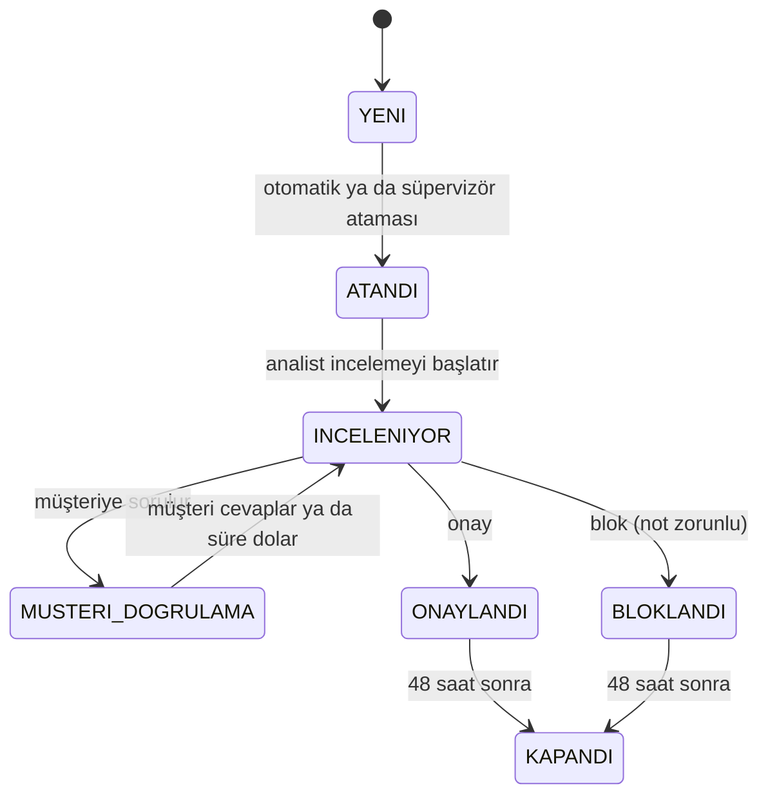

# 05. İş kuralları

## Risk bantları

Yapay zekâ 0–1 arası bir skor üretir. Karar ve risk seviyesi bu skordan tek bir yerde türetilir
([RiskThresholds.cs](../BACKEND/src/Services/Transaction/FraudCell.Transaction.Service/Domain/RiskThresholds.cs)):

| Skor | Karar | Risk | SLA önceliği | SLA süresi |
|---|---|---|---|---|
| < 0,40 | ONAY | Düşük | — (vaka açılmaz) | — |
| 0,40 – 0,70 | İNCELEME | Orta | Orta | 4 saat |
| 0,70 – 0,90 | İNCELEME | Yüksek | Yüksek | 1 saat |
| > 0,90 | BLOK (geçici) | Kritik | Kritik | 15 dakika |

AI bir sonuç dönemezse risk "Belirsiz" gösterilir. Sahte bir "düşük risk" asla yazılmaz; vaka manuel kuyruğa düşer.

## Vaka durum makinesi

Geçişler yalnızca [RiskCase.cs](../BACKEND/src/Services/Transaction/FraudCell.Transaction.Service/Domain/RiskCase.cs)
içindeki metotlarla yapılır. Geçersiz bir geçiş `409 INVALID_CASE_TRANSITION` döner. Her geçiş `case_transitions`
tablosuna kim, ne zaman ve neden bilgisiyle yazılır; analist ekranındaki "Vaka geçmişi" bu tablodur.

## Atama

1. AI, vakanın türüne ve bölgesine uyan analistleri aday olarak sıralar.
2. Transaction adaylar içinden **aktif, atamaya açık ve 10'dan az aktif vakası olan** ilk analisti seçer
   ([AssignmentService.cs](../BACKEND/src/Services/Transaction/FraudCell.Transaction.Service/Common/AssignmentService.cs)).
3. Uygun analist yoksa vaka **kapasite kuyruğuna** (`QUEUED`) girer. Tür "Belirsiz" ise vaka **manuel kuyruğa**
   (`MANUAL_QUEUE`) düşer.
4. Süpervizör kuyruktan atar ya da yeniden atar; gerekçe zorunludur. Pasif ya da atamaya kapalı bir analiste atama
   reddedilir.

## SLA

- Sayaç vaka açılınca başlar, karar verilince durur.
- Durum: geçen sürenin %75'ine kadar Normal, %90'a kadar Uyarı, sonrası Acil; süre bitince Aşıldı.
- Aşılan SLA hem analist listesinde hem süpervizör panelinde en üste çıkar; Kritik kırmızı, Yüksek turuncu boyanır.
- SLA aşımı analiste −5 puan yazar.

## Müşteri doğrulaması

- Analist inceleme sırasında müşteriye "Bu işlemi sen mi yaptın?" diye sorabilir. Müşteri 10 dakika içinde
  "Ben yaptım" ya da "Ben yapmadım" der.
- "Ben yapmadım" cevabı işlemi hemen geçici olarak bloke eder.
- Müşterinin cevabı, kararın doğru olup olmadığının **tek gerçek kaynağıdır** (ground truth). Puanlar ve yapay
  zekânın doğruluk metrikleri buna göre hesaplanır.

## Puan tablosu

[PointRuleEngine.cs](../BACKEND/src/Services/Gamification/FraudCell.Gamification.Service/Common/PointRuleEngine.cs):

| Kural | Puan | Koşul |
|---|---|---|
| Vaka kararı | +10 | Her karar |
| Hızlı karar | +5 | Vaka açılışından 15 dakika içinde |
| Doğrulanmış dolandırıcılık | +15 | Blok **ve** müşteri "ben yapmadım" dedi |
| Kritik vaka SLA içinde | +15 | Kritik vaka süresi bitmeden çözüldü |
| SLA ihlali | −5 | Süre aşıldı |
| Yanlış pozitif | −8 | Blok ama müşteri "ben yaptım" dedi |

Örnek: Kritik bir vakada analist müşteriye sordu, müşteri "ben yapmadım" dedi ve analist 9. dakikada blokladı:
10 + 5 + 15 + 15 = **45 puan**.

Hackathon sürümünde her blok +15 alıyordu; bu, analisti her şeyi bloklamaya teşvik eden bir hataydı. Önce bunu yakalayan
bir test yazdım, sonra kuralı müşterinin cevabına bağladım.

## Rozetler ve seviyeler

| Rozet | Koşul |
|---|---|
| İlk Yakalama | İlk doğrulanmış dolandırıcılık |
| Keskin Göz | 15 dakikanın altında 10 karar |
| Maratoncu | Bir günde 20 karar |
| Kriz Yöneticisi | SLA içinde 10 kritik vaka |
| Sıfır Hata | Yanlış pozitif olmadan 50 karar |
| Uzman Avcı | Tek fraud türünde 50 doğrulanmış yakalama |

Seviyeler: Bronz 0–499, Gümüş 500–1499, Altın 1500–2999, Platin 3000 ve üzeri.

## Kapanış ve geri bildirim

Karar verilen vaka 48 saat sonra `KAPANDI` olur
([CaseClosureWorker.cs](../BACKEND/src/Services/Transaction/FraudCell.Transaction.Service/BackgroundJobs/CaseClosureWorker.cs)).
Bu süre `CASE_CLOSURE_DELAY` ile ayarlanır; CI'daki tarayıcı testi bunu 5 saniyeye indirir. Kapanan vakayı müşteri 1–5
yıldızla değerlendirir.
