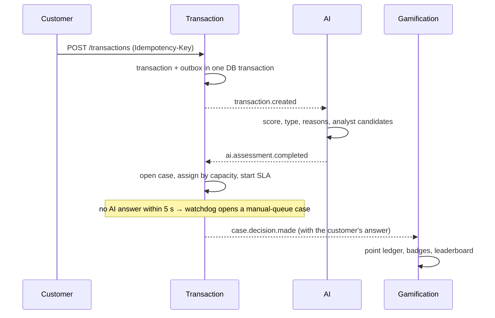

# 03. Architecture

## The big picture

```mermaid
flowchart LR
  B[Browser] -->|HTTPS| G[Edge Gateway YARP]
  G --> W[web nginx SPA]
  G --> I[Identity .NET]
  G --> T[Transaction .NET]
  G --> GM[Gamification .NET]
  G --> A[AI FastAPI]
  G -->|SSE| N[Notification .NET]
  I --- DBI[(identity-db)]
  T --- DBT[(transaction-db)]
  GM --- DBG[(gamification-db)]
  A --- DBA[(ai-db)]
  I <-->|events| R{{RabbitMQ}}
  T <--> R
  GM <--> R
  A <--> R
  N <-- R
```

| Service | Responsibility | Tech |
|---|---|---|
| Edge Gateway | Single entry point: routing, JWT checks, rate limits, security headers | ASP.NET Core 10, YARP 2.3 |
| Identity | Customer OTP sign-in, staff sign-in, sessions, staff management, audit log, JWKS | ASP.NET Core Identity, Argon2id |
| Transaction | Transactions, risk cases, assignment, SLA, customer verification, decisions, feedback | EF Core 10, Npgsql |
| AI | Risk score, fraud type, analyst candidates, explanations, model metrics | FastAPI, scikit-learn 1.5, SQLAlchemy 2 |
| Gamification | Point ledger, badges, levels, leaderboard, analyst performance | EF Core 10 |
| Notification | Pushes events to the browser live (Server-Sent Events) | ASP.NET Core 10 |
| web | Serves the React SPA | nginx (unprivileged) |

Endpoint counts, from the code: Identity 23, Transaction 20, AI 12, Gamification 7, Notification 2.

## Why microservices, and why these boundaries

**Problem:** The case says a transaction must not be lost when the AI is down, and that when one component fails the
rest keeps working. In a single application, a slow AI would slow the payment path too.

**Solution:** Each business area has its own service and its own database. Services don't call each other
synchronously; they publish events over RabbitMQ.

**Trade-off:** I took on the usual distributed problems: duplicate delivery, ordering, eventual consistency, and starting
seven containers together. Outbox/inbox and a one-command compose file handle them.

## The journey of a transaction



1. The customer submits a transaction. Transaction writes it and the `transaction.created` event in **the same database
   transaction**
   ([CreateTransactionEndpoint.cs](../../BACKEND/src/Services/Transaction/FraudCell.Transaction.Service/Features/Transactions/CreateTransaction/CreateTransactionEndpoint.cs)).
2. The outbox publisher sends the event to RabbitMQ
   ([OutboxPublisherService.cs](../../BACKEND/src/BuildingBlocks/FraudCell.BuildingBlocks/Messaging/Outbox/OutboxPublisherService.cs)).
3. The AI scores it and publishes `ai.assessment.completed`, including analyst candidates.
4. Transaction opens a case and picks the first candidate with capacity
   ([AssignmentService.cs](../../BACKEND/src/Services/Transaction/FraudCell.Transaction.Service/Common/AssignmentService.cs)).
5. If the AI hasn't answered within 5 seconds,
   [AssessmentWatchdogWorker.cs](../../BACKEND/src/Services/Transaction/FraudCell.Transaction.Service/BackgroundJobs/AssessmentWatchdogWorker.cs)
   opens the case with an "unknown" risk in the manual queue. Nothing is lost.

## Events and delivery guarantees

- **Outbox:** The event is written to `outbox_messages` in the same database transaction as the business data, and a
  separate worker publishes it. "Saved the data but lost the event" can't happen.
- **Inbox:** Every consumer records the ids of the events it handled in `inbox_messages` and skips repeats
  ([RabbitMqConsumerHostedService.cs](../../BACKEND/src/BuildingBlocks/FraudCell.BuildingBlocks/Messaging/RabbitMq/RabbitMqConsumerHostedService.cs)).
- Full list: [EVENTS.md](../../BACKEND/EVENTS.md).

## Shared code

[FraudCell.BuildingBlocks](../../BACKEND/src/BuildingBlocks/FraudCell.BuildingBlocks/) shares infrastructure only: the
API envelope, the error contract, ETags, outbox/inbox, RabbitMQ and JWT validation. It holds no domain concepts such as
`Transaction` or `RiskCase`; every service owns its model.

## Runtime

- One command: `docker compose up` starts seven application containers, four Postgres instances and RabbitMQ
  ([docker-compose.yml](../../BACKEND/docker-compose.yml)).
- Each database sits only on its own service's private network; no other service can reach it.
- The `demo-seed` container creates the demo staff. The gateway starts without waiting for every service, so a failed
  service only affects its own endpoints.
- Resilience test: the `resilience` step of [scripts/demo.py](../../scripts/demo.py) stops each container in turn
  (RabbitMQ included) and checks in CI that the system recovers.
