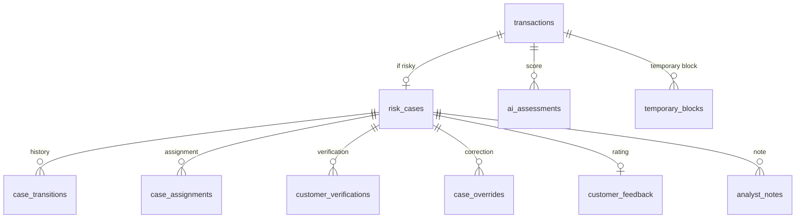

# 04. Database

## One database per service

| Database | Owner | Tables | Migrations |
|---|---|---|---|
| `fraudcell_identity` | Identity | 19 (including ASP.NET Identity's) | EF Core |
| `fraudcell_transaction` | Transaction | 16 | EF Core |
| `fraudcell_gamification` | Gamification | 12 | EF Core |
| `fraudcell_ai` | AI | 14 | Alembic |

There are four separate Postgres 18 containers, each attached only to its own service's private network.

**Problem:** On the hackathon night all four databases lived in one Postgres. Any service could have read another's
tables; the boundaries existed only on paper.

**Solution:** A Postgres and a network per service. When a service needs another's data, it keeps a **projection**
built from that service's events. For example, Transaction keeps analysts' specialties and availability in
`analyst_eligibility_projection`, fed by Identity's `identity.staff.profile.updated`.

**Trade-off:** Data can be briefly stale (eventual consistency), so at assignment time the analyst's active and
assignable state is checked once more against the current record.

## Transaction schema (core)

## Rules the database enforces

Even if the code has a bug, the database rejects bad data
([TransactionServiceDbContext.cs](../../BACKEND/src/Services/Transaction/FraudCell.Transaction.Service/Persistence/TransactionServiceDbContext.cs)):

| Rule | How |
|---|---|
| A transaction has at most one case | `ux_risk_cases_transaction` unique index |
| A case has one active assignment at a time | `ux_case_assignments_active_case`, a unique index filtered to `ASSIGNED/IN_PROGRESS` |
| An analyst carries at most 10 active cases | `ck_analyst_workloads_range` check constraint |
| Amounts are positive | `ck_transactions_amount` |
| A KAPANDI (closed) case has a closing time | `ck_risk_cases_closed` |
| The same AI result is never applied twice | `ux_ai_assessments_source_event` |
| Transaction numbers are unique | `ux_transactions_no`, drawn from a per-year counter table |

## Concurrency: ETag and If-Match

What if two supervisors assign the same case to different analysts at the same moment? Every writable record has a
`version` column (an EF Core concurrency token). `GET` returns `ETag: "7"`, writes require `If-Match: "7"`:

- No header: **428 Precondition Required**.
- Stale version: **412 Precondition Failed** (`RESOURCE_VERSION_MISMATCH`), with the expected and current versions.
- If two requests slip through in the same instant, EF Core's concurrency token catches the second one with **409**.

Code: [ETagHelper.cs](../../BACKEND/src/BuildingBlocks/FraudCell.BuildingBlocks/Api/ETagHelper.cs). On 412 the UI asks
the user to reload, so nobody overwrites someone else's decision without noticing.

## Against duplicate submissions: Idempotency-Key

If the customer taps "send" twice or the network retries, there must not be two payments. `POST /transactions` requires
an `Idempotency-Key` header; keys are stored in `idempotency_records`, and a second request with the same key gets the
first response.

## Outbox and inbox tables

Every service's schema has `outbox_messages` and `inbox_messages`. See
[03 Architecture](03-architecture.md#events-and-delivery-guarantees).

## The point ledger (Gamification)

`point_ledger` is an append-only ledger. Totals, levels and leaderboards live in summary tables derived from it
(`analyst_score_summaries`, `analyst_daily_stats`, `analyst_weekly_stats`). A second row for the same event and rule
can't be written, so one decision never pays twice.

## Migrations

- .NET services apply their EF Core migrations on startup (`InitialCreate` in each).
- The AI schema is managed with Alembic
  ([0001_initial_schema.py](../../BACKEND/src/Ai/fraudcell-ai/migrations/versions/0001_initial_schema.py)); a separate
  `ai-migrate` step runs before the service starts.
- Seed data: roles, specialties, regions and badge definitions are kept current on every start; demo staff come from
  `demo-seed`.
