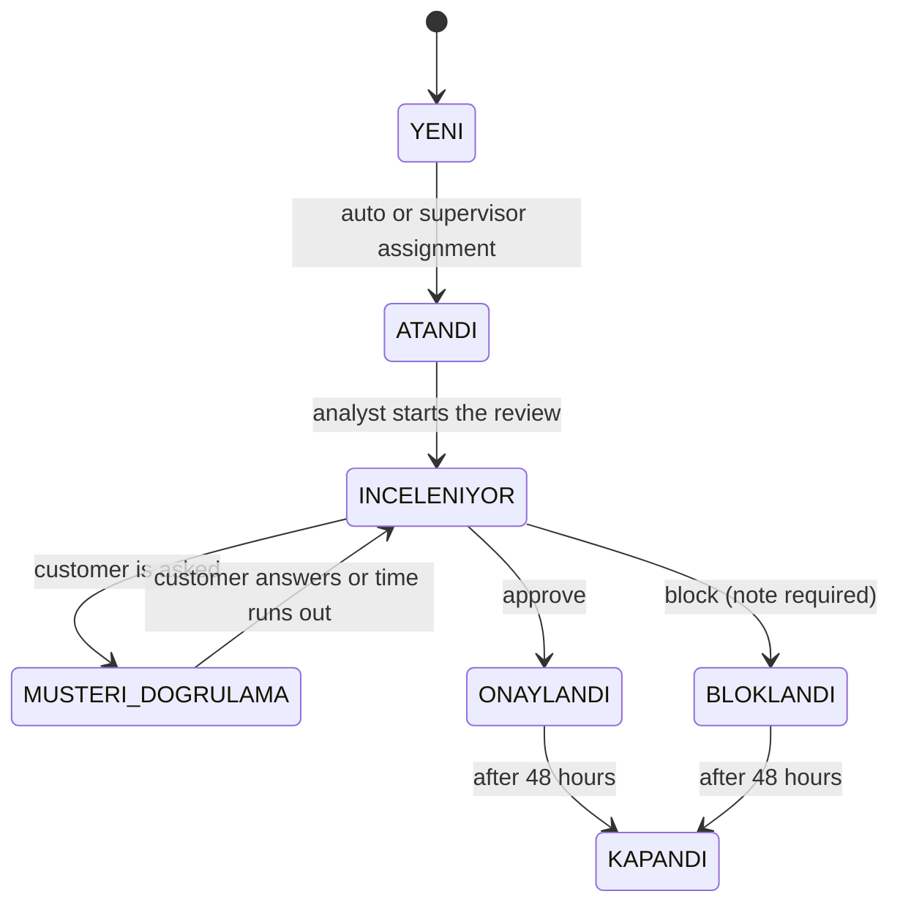

# 05. Domain rules

## Risk bands

The AI returns a score between 0 and 1. The decision and the risk level come from that score in one place
([RiskThresholds.cs](../../BACKEND/src/Services/Transaction/FraudCell.Transaction.Service/Domain/RiskThresholds.cs)):

| Score | Decision | Risk | SLA priority | SLA window |
|---|---|---|---|---|
| < 0.40 | ONAY (approve) | Low | — (no case) | — |
| 0.40 – 0.70 | İNCELEME (review) | Medium | Medium | 4 hours |
| 0.70 – 0.90 | İNCELEME (review) | High | High | 1 hour |
| > 0.90 | BLOK (temporary block) | Critical | Critical | 15 minutes |

When the AI can't answer, the risk is shown as "unknown". A fake "low risk" is never written; the case goes to the
manual queue.

## Case state machine

Transitions happen only through the methods of
[RiskCase.cs](../../BACKEND/src/Services/Transaction/FraudCell.Transaction.Service/Domain/RiskCase.cs). An invalid
transition returns `409 INVALID_CASE_TRANSITION`. Every transition is written to `case_transitions` with who, when and
why; the "case history" on the analyst's screen is that table.

## Assignment

1. The AI ranks analysts who match the case's type and region.
2. Transaction picks the first candidate who is **active, open to assignment and has fewer than 10 active cases**
   ([AssignmentService.cs](../../BACKEND/src/Services/Transaction/FraudCell.Transaction.Service/Common/AssignmentService.cs)).
3. If nobody fits, the case waits in the **capacity queue** (`QUEUED`). If the type is unknown, it goes to the
   **manual queue** (`MANUAL_QUEUE`).
4. A supervisor assigns or reassigns from the queue, with a required reason. Assigning to an inactive or closed analyst
   is refused.

## SLA

- The clock starts when the case opens and stops at the decision.
- Status: Normal up to 75% of the window, Warning up to 90%, Urgent after that; Breached once it runs out.
- Breached cases go to the top of the analyst's list and the supervisor's dashboard; critical ones in red, high ones in
  orange.
- A breach costs the analyst 5 points.

## Customer verification

- During a review the analyst can ask the customer "was this you?". The customer has 10 minutes to answer "it was me" or
  "it wasn't me".
- "It wasn't me" puts the transaction on a temporary block straight away.
- The customer's answer is the **only ground truth** for whether a decision was right. Analyst points and the model's
  accuracy metrics are both computed from it.

## Point table

[PointRuleEngine.cs](../../BACKEND/src/Services/Gamification/FraudCell.Gamification.Service/Common/PointRuleEngine.cs):

| Rule | Points | When |
|---|---|---|
| Case decision | +10 | Every decision |
| Fast decision | +5 | Within 15 minutes of the case opening |
| Confirmed fraud | +15 | Block **and** the customer said "it wasn't me" |
| Critical within SLA | +15 | A critical case solved in time |
| SLA breach | −5 | The window ran out |
| False positive | −8 | Block, but the customer said "it was me" |

Example: on a critical case the analyst asks the customer, the customer says "it wasn't me", and the analyst blocks at
minute 9: 10 + 5 + 15 + 15 = **45 points**.

In the hackathon version every block earned +15, which rewarded blocking everything. I wrote a test that caught it, then
tied the rule to the customer's answer.

## Badges and levels

| Badge | When |
|---|---|
| İlk Yakalama (First Catch) | First confirmed fraud |
| Keskin Göz (Sharp Eye) | 10 decisions under 15 minutes |
| Maratoncu (Marathoner) | 20 decisions in a day |
| Kriz Yöneticisi (Crisis Manager) | 10 critical cases within SLA |
| Sıfır Hata (Zero Error) | 50 decisions with no false positive |
| Uzman Avcı (Specialist Hunter) | 50 confirmed catches of one fraud type |

Levels: Bronze 0–499, Silver 500–1499, Gold 1500–2999, Platinum 3000 and up.

## Closing and feedback

A decided case becomes `KAPANDI` (closed) after 48 hours
([CaseClosureWorker.cs](../../BACKEND/src/Services/Transaction/FraudCell.Transaction.Service/BackgroundJobs/CaseClosureWorker.cs)).
`CASE_CLOSURE_DELAY` sets the delay; the browser test in CI lowers it to 5 seconds. The customer rates a closed case
with 1–5 stars.
